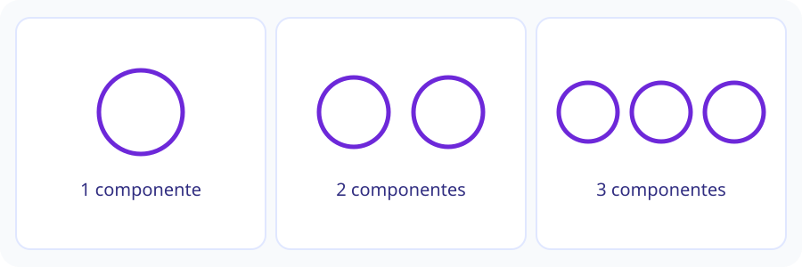

Esta primera entrada tiene un propósito doble: inaugurar este espacio y comprobar que podemos compartir ideas matemáticas acompañadas de fórmulas, diagramas y pequeños experimentos computacionales.

Comencemos con una pregunta sencilla: **¿qué polinomio podemos asociar a una colección de círculos separados?**

## Un poco de matemática

```definition Enlace trivial
Denotamos por $U_n$ el enlace trivial de $n$ componentes, representado mediante $n$ círculos disjuntos y no anidados en el plano, sin cruces.
```



El corchete de Kauffman es un invariante de isotopía regular de diagramas de enlaces. Con la normalización usual, el valor de un círculo sin cruces es $1$. Añadir un círculo separado multiplica el corchete por

$$
\delta=-A^2-A^{-2}.
$$

```proposition Corchete del enlace trivial
Para el diagrama sin cruces de $U_n$, con $n\geq 1$, se tiene

$$
\langle U_n\rangle=(-A^2-A^{-2})^{n-1}.
$$
```

```proof
Procedemos por inducción sobre $n$. Para $n=1$, el resultado es precisamente la normalización $\langle U_1\rangle=1$.

Si la fórmula es válida para $n=k$, la regla del círculo separado nos permite escribir

$$
\begin{aligned}
\langle U_{k+1}\rangle
&=\delta\langle U_k\rangle\\
&=\delta\,\delta^{k-1}=\delta^k.
\end{aligned}
$$

Esto completa la inducción.
```

```example Tres componentes
En particular,

$$
\langle U_3\rangle=A^4+2+A^{-4}.
$$
```

```remark
El corchete no es invariante bajo el primer movimiento de Reidemeister. Para obtener el polinomio de Jones se introduce una corrección mediante el writhe y un cambio de variable.
```

## Un pequeño experimento con Python

Podemos automatizar estos cálculos utilizando [SymPy](https://www.sympy.org/), una biblioteca de cálculo simbólico.

```python
from sympy import symbols, expand

A = symbols('A')

def corchete_trivial(n):
    if n < 1:
        raise ValueError('Se requiere al menos una componente')
    return expand((-A**2 - A**(-2))**(n - 1))

for n in range(1, 5):
    print(n, corchete_trivial(n))
```

Los primeros resultados son:

| Componentes | Corchete |
| --- | --- |
| 1 | $1$ |
| 2 | $-A^2-A^{-2}$ |
| 3 | $A^4+2+A^{-4}$ |
| 4 | $-A^6-3A^2-3A^{-2}-A^{-6}$ |

## Una pregunta para terminar

¿Qué relación tienen los coeficientes de estos polinomios con el triángulo de Pascal?

> No todas las entradas de este blog tendrán un carácter matemático. También habrá espacio para libros, viajes, fotografías, opiniones y otras cosas que me gustaría compartir.

## Lecturas recomendadas

- L. H. Kauffman, *On knots*, Princeton University Press, 1987.
- L. H. Kauffman, *State models and the Jones polynomial*, Topology 26 (1987), 395–407.

---

*Esta es una publicación de prueba de la infraestructura del blog.*
